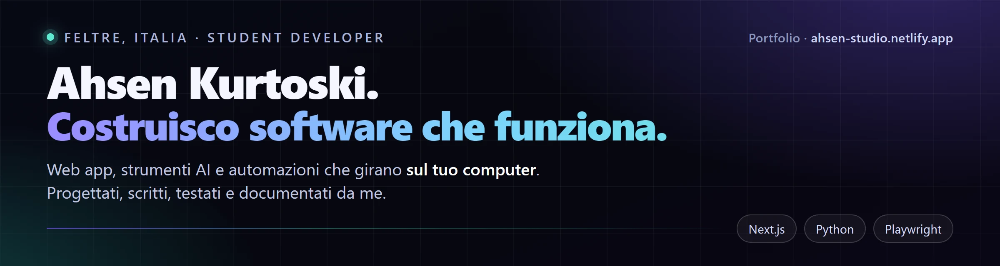

  

  <b>Student developer · Feltre, Italy</b> 🇮🇹 🇲🇰 
  I design, build, test and document web apps, AI tools and automation that run on your own machine.

  
  
  

---

Sono **Ahsen**, 14 anni, Feltre. Costruisco software che funziona: lo progetto, lo scrivo, lo provo su dispositivi veri e lo documento.

I'm 14, based in Feltre (Italy). I build software that a real business can run — self-hosted, documented, and tested on real devices. AI is my assistant for research, review and repetitive work; the architecture, the decisions and the final check are mine.

**Three of those products are working today.** The GIFs below are recordings of the real apps, made on 21 November 2026 — not mockups.

  <b>3 products working today</b> · 5 more live or open source · MIT where it matters · 7 interface languages · €0 in subscriptions

---

## 01 · [WhatsApp Digital Secretary](https://github.com/AhsenKurtoski/whatsapp-digital-secretary)

**A private AI secretary that answers your WhatsApp customers — and never sends an email, a quote or a Calendar event without your approval.**

  

- **Approval-gated by design.** The model can only *request* an email, an event or a quote PDF. It has no Gmail or Calendar tool: the dashboard executes the action after you click.
- **Real business data, real numbers.** Services, prices, hours and tone live in one config file. Quotes recalculate subtotal, discount, VAT and total on the server — the model cannot invent a price.
- **Built for operations.** Encrypted per-customer memory (AES-256-GCM), tamper-evident audit log, TOTP and revocable sessions, encrypted backups, watchdog and WhatsApp health alerts.
- **Try it in 60 seconds.** `python3 demo.py` opens the real dashboard with demo leads and a generated PDF quote. No keys, no WhatsApp account, nothing sent.

`Python 3.11–3.14` · `MIT` · `self-hosted` · `systemd / Docker` — **[Code](https://github.com/AhsenKurtoski/whatsapp-digital-secretary)** · **[Landing](https://gina-secretary.vercel.app)**

---

## 02 · [Lead Machine](https://github.com/AhsenKurtoski/lead-machine)

**A local-first CRM that finds nearby businesses on OpenStreetMap, shows which ones need a website, and verifies every contact before you call.**

  

- **From map to pipeline.** Search by category and radius, deduplicate in three layers, then score each business 0–100 on what it actually has: website, socials, reviews, reachable phone.
- **Verification, not guesses.** Phone, email, website, address and socials each get a verdict, a source and a timestamp. Unknown fields stay *to verify* instead of becoming a false fact.
- **The whole loop.** CRM timeline, WhatsApp/email/call actions, follow-up buckets, payment receipts, reports, and a scoped public API with hashed `lm_live_…` keys.
- **Yours.** One SQLite file, 7 interface languages, optional AI with Gemini/Groq failover, no paid tier.

`Next.js 15` · `TypeScript` · `Prisma + SQLite` · `MIT` — **[Code](https://github.com/AhsenKurtoski/lead-machine)** · **[API docs](https://github.com/AhsenKurtoski/lead-machine/blob/main/API.md)**

---

## 03 · [AhsenDS](https://github.com/AhsenKurtoski/axsends)

**A dropshipping workspace: product research, AI copy and video ads, generated landing pages, publishing to TikTok, Instagram, Facebook and YouTube — self-hosted instead of rented.**

  

- **Research → publish.** Scores products from CJ Dropshipping, writes product pages and ad scripts, builds the landing page, queues the posts with the official platform APIs.
- **Margins in view.** Orders, suppliers, pricing rules, monitoring and diagnostics in one dashboard, with your own keys and your own Supabase project.
- **No fake state.** Without Supabase the interface says so and opens without inventing data.

`Next.js 14` · `TypeScript` · `Tailwind` · `Supabase` · `MIT` — **[Code](https://github.com/AhsenKurtoski/axsends)** · **[Live](https://axsends.vercel.app)**

---

## Also shipped

| Project | What it is | |
|---|---|---|
| **[Atelier](https://websitebuilder-pro.vercel.app/)** | AI website builder: describe a business, get a complete static site with pages, copy, palette, SEO and legal pages, then edit it visually and export. The deterministic composer works with no API key and no account. | [Live](https://websitebuilder-pro.vercel.app/) |
| **[Atlas AI](https://github.com/AhsenKurtoski/atlas-ai)** | Multi-user assistant: FastAPI backend, React Native/Expo client, Gemini tool calling, MCP servers, and a browser agent where every outbound request is checked for SSRF and DNS tricks. | [Code](https://github.com/AhsenKurtoski/atlas-ai) |
| **[UnionTV OS Experience](https://github.com/AhsenKurtoski/UnionTV-OS-Experience)** | Native Android TV launcher written for a 1.4 GB TCL box (Android 9, ARMv7, 720p) that modern launchers give up on. Java, signed releases. | [Code](https://github.com/AhsenKurtoski/UnionTV-OS-Experience) |
| **[Prenota Diretto](https://github.com/AhsenKurtoski/prenota-diretto)** | Direct-booking kit for agriturismi and B&Bs: booking page, emails, WhatsApp messages, Google profile checklist. One payment, no subscription. | [Code](https://github.com/AhsenKurtoski/prenota-diretto) |
| **[Locanda del Re](https://locandadelre.netlify.app/)** | Restaurant and rooms site, live with real content: menu, gallery, booking requests, bilingual. | [Live](https://locandadelre.netlify.app/) |

---

## How I build

1. **Understand the problem before the code.** Who uses it, what breaks today, what the smallest useful version is.
2. **Decide, then write.** Data model and interfaces sketched before the first component — the reason Lead Machine's API has scopes that are actually enforced, not labels.
3. **Test on real devices, not just my laptop.** Mobile widths, slow connections, keyboard navigation, empty and error states.
4. **Ship it and write it down.** README someone can follow, screenshots from the running app, limitations stated instead of hidden.

---

## Stack

| Area | Tools |
|---|---|
| Frontend | React, Next.js, TypeScript, Tailwind, HTML/CSS |
| Backend & data | Node.js, Python, FastAPI, Prisma, SQLite, Supabase |
| AI | Gemini, Groq, OpenRouter, function calling, MCP |
| Infra & quality | Docker, GitHub Actions, Playwright, Linux, Netlify, Vercel |

  
  
  
  
  
  

---

## Right now

- Raising the quality bar of the sites Atelier generates: contrast, keyboard navigation, real mobile testing.
- Looking for **pro bono pilots** with schools, associations or small municipalities that have a real problem worth solving.
- Writing about what I build, in Italian, on the [portfolio](https://ahsen-studio.netlify.app/blog).

---

## Contact

Open to collaborations, open-source contributions and pilots with organisations.

**Email:** cshop0784@gmail.com · **Portfolio:** https://ahsen-studio.netlify.app/ · **Languages:** Italian · English · Macedonian

> I'm 14 and I learn in public. Everything here is built by me, with AI as an assistant — the decisions and the final check are mine.
