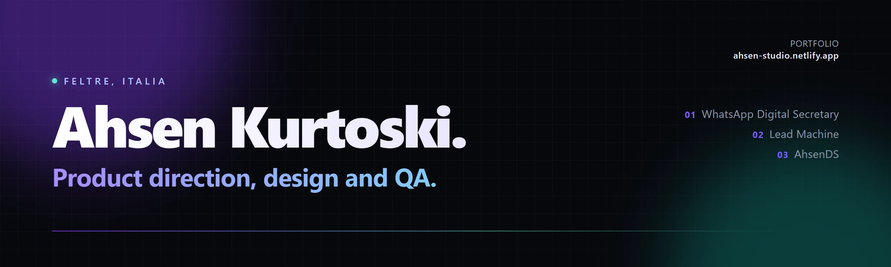
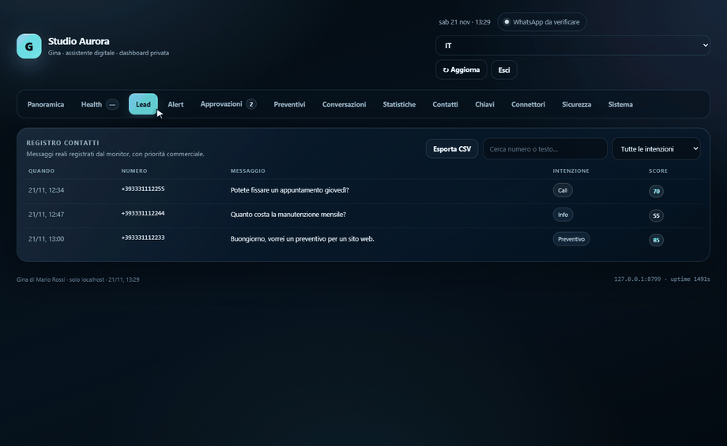
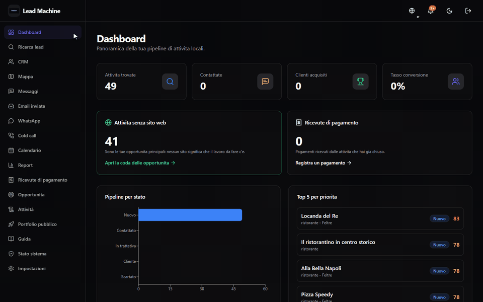
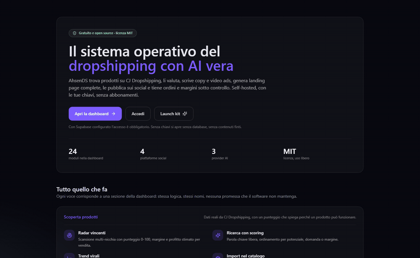

  

  <b>Product direction · interface design · quality control</b> 
  I decide what gets built, how it should look, and when it is done.

  
  
  

---

Sono **Ahsen**, da Feltre. Costruisco i prodotti che vedi qui: decido cosa entra nello scope, progetto l'interfaccia, scrivo le specifiche, leggo ogni modifica contro quelle specifiche, eseguo la matrice di test del progetto e decido io quando una release è pubblicabile. L'implementazione è assistita dall'AI: la revisione, i test e la decisione su cosa pubblicare sono miei.

I'm 14 and based in Feltre, Italy. I build the products on this page: I decide the scope, design the interface, write the specification, read every change against it, run the project's test matrix and decide when a release is ready. Implementation is AI-assisted: the review, the tests and the call on what ships are mine.

**What that means on every project here:**

- **Product** — the scope, the priorities, and what stays out.
- **Design** — screens, states, typography, colour, and the words on them.
- **Specification** — flows, data, edge cases and acceptance criteria, written before anything is built.
- **Quality** — real devices, empty and error states, keyboard navigation, contrast. I break it before a customer does.

**Three of these products are working today.** The GIFs below are recordings of the real apps, made on 21 November 2026 — not mockups. Each one has a case study: the problem, the decisions, the architecture, what the tests cover and what they do not.

---

## 01 · [WhatsApp Digital Secretary](https://github.com/AhsenKurtoski/whatsapp-digital-secretary)

**A private AI secretary that answers your WhatsApp customers — and never sends an email, a quote or a Calendar event without your approval.**

  

- **Approval-gated by design.** The assistant can only *request* an email, an event or a quote PDF. It has no Gmail or Calendar tool: the dashboard executes the action after you click.
- **Real business data, real numbers.** Services, prices, hours and tone live in one config file. Quotes recalculate subtotal, discount, VAT and total on the server — the assistant cannot invent a price.
- **Built for operations.** Encrypted per-customer memory (AES-256-GCM), tamper-evident audit log, TOTP and revocable sessions, encrypted backups, watchdog and WhatsApp health alerts.
- **Try it in 60 seconds.** `python3 demo.py` opens the real dashboard with demo leads and a generated PDF quote. No keys, no WhatsApp account, nothing sent.

`Python 3.11–3.14` · `MIT` · `self-hosted` · `systemd / Docker` — **[Case study](projects/whatsapp-digital-secretary.md)** · **[Code](https://github.com/AhsenKurtoski/whatsapp-digital-secretary)** · **[Landing](https://gina-secretary.vercel.app)**

---

## 02 · [Lead Machine](https://github.com/AhsenKurtoski/lead-machine)

**A local-first CRM that finds nearby businesses on OpenStreetMap, shows which ones need a website, and verifies every contact before you call.**

  

- **From map to pipeline.** Search by category and radius, deduplicate in three layers, then score each business 0–100 on what it actually has: website, socials, reviews, reachable phone.
- **Verification, not guesses.** Phone, email, website, address and socials each get a verdict, a source and a timestamp. Unknown fields stay *to verify* instead of becoming a false fact.
- **The whole loop.** CRM timeline, WhatsApp/email/call actions, follow-up buckets, payment receipts, reports, and a scoped public API with hashed `lm_live_…` keys.
- **Yours.** One SQLite file, 7 interface languages, optional AI with Gemini/Groq failover, no paid tier.

`Next.js 15` · `TypeScript` · `Prisma + SQLite` · `MIT` — **[Case study](projects/lead-machine.md)** · **[Code](https://github.com/AhsenKurtoski/lead-machine)** · **[API docs](https://github.com/AhsenKurtoski/lead-machine/blob/main/API.md)**

---

## 03 · [AhsenDS](https://github.com/AhsenKurtoski/axsends)

**A dropshipping workspace: product research, AI copy and video ads, generated landing pages, publishing to TikTok, Instagram, Facebook and YouTube — self-hosted instead of rented.**

  

- **Research → publish.** Scores products from CJ Dropshipping, writes product pages and ad scripts, builds the landing page, queues the posts with the official platform APIs.
- **Margins in view.** Orders, suppliers, pricing rules, monitoring and diagnostics in one dashboard, with your own keys and your own Supabase project.
- **No fake state.** Without Supabase the interface says so and opens without inventing data.

`Next.js 14` · `TypeScript` · `Tailwind` · `Supabase` · `MIT` — **[Case study](projects/ahsend.md)** · **[Code](https://github.com/AhsenKurtoski/axsends)** · **[Live](https://axsends.vercel.app)**

---

## Also shipped

- **[Atelier](https://websitebuilder-pro.vercel.app/)** — AI website builder: describe a business, get a complete static site with pages, copy, palette, SEO and legal pages, then edit it visually and export. The composer works with no API key and no account. — [Live](https://websitebuilder-pro.vercel.app/)
- **[Atlas AI](https://github.com/AhsenKurtoski/atlas-ai)** — multi-user assistant: FastAPI backend, React Native client, Gemini tool calling, MCP servers, and a browser agent where every outbound request is checked for SSRF and DNS tricks. — [Code](https://github.com/AhsenKurtoski/atlas-ai)
- **[UnionTV OS Experience](https://github.com/AhsenKurtoski/UnionTV-OS-Experience)** — native Android TV launcher for a 1.4 GB TCL box that modern launchers give up on. Java, signed releases. — [Code](https://github.com/AhsenKurtoski/UnionTV-OS-Experience)
- **[Locanda del Re](https://locandadelre.netlify.app/)** — restaurant and rooms site, live with real content: menu, gallery, booking requests, bilingual. — [Live](https://locandadelre.netlify.app/)

---

## How a project runs

1. **The problem.** Who has it, what breaks today, what the smallest useful version is.
2. **The plan.** Scope, screens, data model, edge cases, acceptance criteria — written down before anything is built.
3. **The design.** Layout, type, colour, states and copy. I choose and review every screen.
4. **The build.** Small increments, one flow at a time, each with its own acceptance criteria — a quote from request to PDF, a lead from search to a verified phone number.
5. **The check.** Empty and error states, keyboard navigation, contrast, slow connections. Nothing is "done" because it compiles.

---

## Stack

- **Frontend** — React, Next.js, TypeScript, Tailwind, HTML/CSS
- **Backend & data** — Node.js, Python, FastAPI, Prisma, SQLite, Supabase
- **AI** — Gemini, Groq, OpenRouter, function calling, MCP
- **Infra & quality** — Docker, GitHub Actions, Playwright, Linux, Netlify, Vercel

---

## Right now

- Raising the quality bar of the sites Atelier generates: contrast, keyboard navigation, real mobile testing.
- Looking for **pro bono pilots** with schools, associations or small municipalities that have a real problem worth solving.
- Writing about what I build, in Italian, on the [portfolio](https://ahsen-studio.netlify.app/blog).

---

## Contact

Open to collaborations, open-source contributions and pilots with organisations.

**Email:** cshop0784@gmail.com · **Portfolio:** https://ahsen-studio.netlify.app/ · **Languages:** Italian · English · Macedonian
