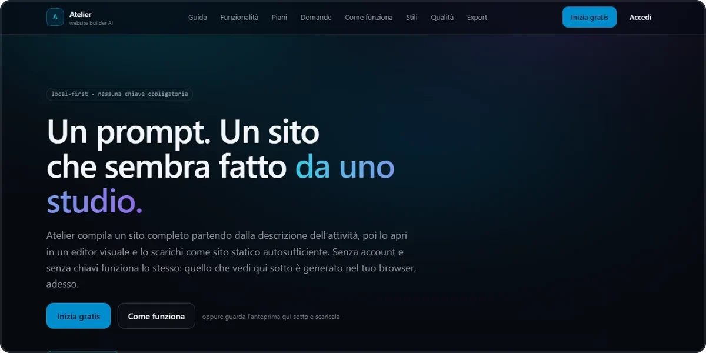
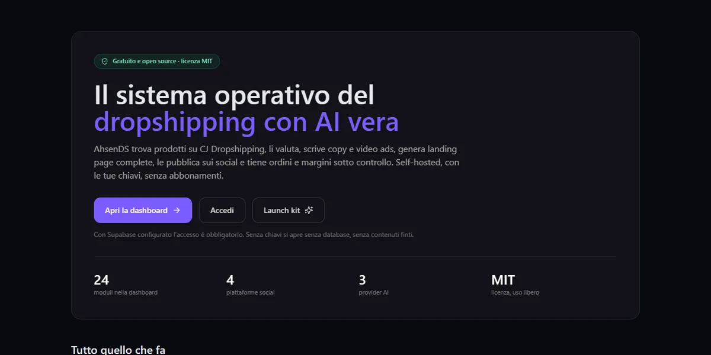
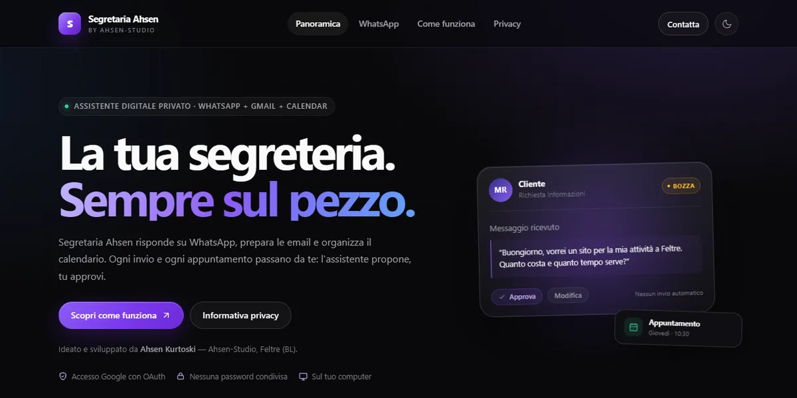
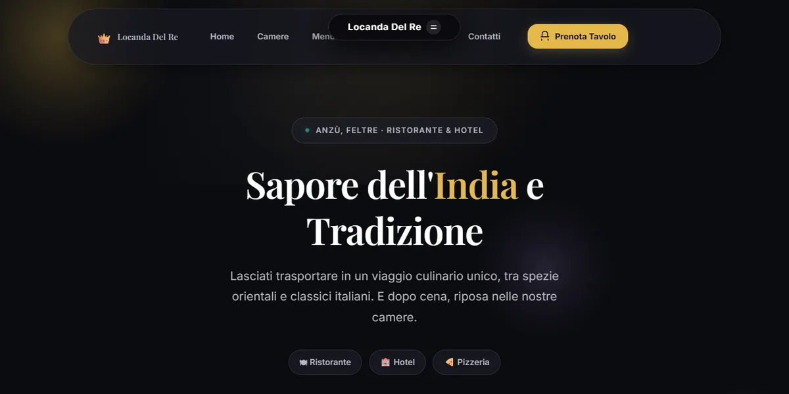

  

  <b>Student developer · Feltre, Italy</b> 🇮🇹 🇲🇰 
  Web apps, AI tools and automation — local-first, open source, documented.

  
  
  

---

Sono **Ahsen**, 14 anni, Feltre. Costruisco siti, web app e strumenti AI che funzionano davvero: li progetto, li scrivo, li provo su dispositivi veri e li documento.

I'm 14, based in Feltre (Italy). I build web applications, AI tools and automation that run on your own machine — designed, written, tested and documented by me.

---

## What I do

| | |
|---|---|
| **Web applications** | React, Next.js and TypeScript, from the first screen to production: auth, data, dashboards, deploys. |
| **AI that does a job** | Assistants and agents wired into real workflows, with approvals where a mistake is expensive. |
| **Automation** | Scripts and pipelines that remove repetitive work: data collection, reports, backups, publishing. |
| **The boring parts** | Empty and error states, keyboard navigation, contrast, performance on a mid-range phone, READMEs someone can follow. |

---

## Shipped — live sites, not mockups

  
  

  
  

Atelier · AhsenDS · Segretaria Ahsen · Locanda del Re — screenshots from the live sites

---

## Selected work

### [Lead Machine](https://github.com/AhsenKurtoski/lead-machine) · open-source CRM

Freelancers and small agencies find clients in spreadsheets, tabs and notes. Lead Machine puts the whole loop in one self-hosted app: search businesses on OpenStreetMap, score them, verify contacts, manage quotes and invoices.

- **Why:** the paid alternatives cost more per month than a freelance site earns in a week.
- **How:** Next.js 15 App Router, TypeScript strict, Prisma + a single SQLite file, Leaflet + OpenStreetMap, optional AI providers with failover.
- **Details:** MIT license, 7 interface languages, offline except for the map and the optional AI calls.
- [Code](https://github.com/AhsenKurtoski/lead-machine)

### [Atelier](https://websitebuilder-pro.vercel.app/) · AI website builder

Describe a business, get a complete static site: pages, copy, palette, SEO, legal pages, an editorial editor and a clean export.

- **Why:** a small business should not need an €800 quote to have a correct website.
- **How:** a deterministic composer builds the site in the browser, so it works with **no API key and no account**; AI is an optional accelerator.
- **Details:** preview and export come from the same markup tree — what you see is the file you publish.
- [Live](https://websitebuilder-pro.vercel.app/)

### [Segretaria Ahsen / WhatsApp Digital Secretary](https://github.com/AhsenKurtoski/whatsapp-digital-secretary) · self-hosted assistant

A secretary that answers customers on WhatsApp using your own business data, and can read Gmail or book Calendar events only after you approve the action.

- **Why:** small businesses lose messages outside working hours, but a chatbot with full access to email is not acceptable.
- **How:** Python service, approval-gated tool calls, private dashboard, health alerts, Docker and systemd.
- [Code](https://github.com/AhsenKurtoski/whatsapp-digital-secretary) · [Landing](https://ahsenkurtoski.github.io/ahsen-studio-site/)

### [Atlas AI](https://github.com/AhsenKurtoski/atlas-ai) · multi-user AI assistant

A family assistant with separate accounts, a real browser agent and tool calling, built around one rule: every outbound request is checked for SSRF and DNS tricks.

- **How:** FastAPI backend, React Native/Expo client, Gemini function calling, MCP servers.
- **Details:** per-user data separation, allow-listed commands, no secrets in the client.
- [Code](https://github.com/AhsenKurtoski/atlas-ai)

### [AhsenDS](https://github.com/AhsenKurtoski/axsends) · dropshipping automation

Product research, a radar for winning products, AI video ads and publishing to TikTok, Instagram, Facebook and YouTube — self-hosted instead of rented.

- **How:** Next.js 14, TypeScript, Tailwind, Supabase.
- [Code](https://github.com/AhsenKurtoski/axsends) · [Live](https://axsends.vercel.app)

### [UnionTV OS Experience](https://github.com/AhsenKurtoski/UnionTV-OS-Experience) · Android TV launcher

A native launcher for a TCL UnionTV box (Android 9, ARMv7, 720p, 1.4 GB RAM): fast on hardware modern launchers give up on.

- **Details:** Java, signed releases, documented screenshots with Wi-Fi details redacted.
- [Code](https://github.com/AhsenKurtoski/UnionTV-OS-Experience)

### [Prenota Diretto](https://github.com/AhsenKurtoski/prenota-diretto) · booking kit for small stays

A ready-made direct booking kit for agriturismi and B&Bs: booking page, emails, WhatsApp messages and a Google profile checklist. One payment, no subscription.

---

## Stack

| Area | Tools |
|---|---|
| Frontend | React, Next.js, TypeScript, Tailwind, HTML/CSS |
| Backend & data | Node.js, Python, FastAPI, Prisma, SQLite, Supabase |
| AI | Gemini, Groq, OpenRouter, function calling, MCP |
| Infra & quality | Docker, GitHub Actions, Playwright, Linux, Netlify, Vercel |

  
  
  
  
  
  

---

## How I work

1. **Understand the problem first.** Who uses it, what breaks today, what the smallest useful version is.
2. **Decide before coding.** Structure, data and interface sketched before the first component.
3. **Build, then test on real devices.** Not only on my laptop, not only in one browser.
4. **Ship and write it down.** What worked, what did not, what I would change.

I use AI as an assistant for research, reviews and repetitive work. The decisions, the architecture and the final check are mine — and every project here is something I can explain line by line.

---

## Currently

- Raising the quality bar of the sites Atelier generates: contrast, keyboard navigation, real mobile testing.
- Looking for **pro bono pilots** with schools, associations or small municipalities that have a real problem worth solving.
- Writing about what I build, in Italian, on the [portfolio](https://ahsen-studio.netlify.app/blog).

---

## Contact

Open to collaborations, open-source contributions and pilots with organisations.

**Email:** cshop0784@gmail.com
**Portfolio:** https://ahsen-studio.netlify.app/
**Languages:** Italian · English · Macedonian

> I'm 14 and I learn in public. Everything here is built by me, with AI as an assistant — the decisions and the final check are mine.
