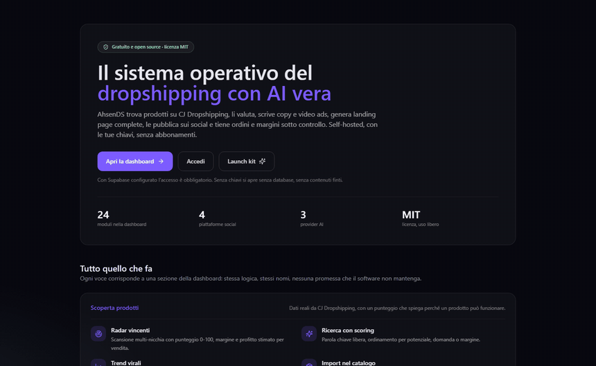

# AhsenDS

**A self-hosted dropshipping workspace: product research, AI copy, video ads with burned-in subtitles, generated landing pages, and publishing to TikTok, Instagram, Facebook and YouTube — with your own keys and no subscription.**

`Next.js 14` · `TypeScript` · `Tailwind` · `Supabase` · `MIT` — [Code](https://github.com/AhsenKurtoski/axsends) · [Live](https://axsends.vercel.app) · [Launch kit](https://axsends.vercel.app/launch) · [← Back to profile](../README.md)

  

Recorded from the live application at axsends.vercel.app, 21 November 2026. Not a mockup.

---

## 1. The problem

Dropshipping is not one job. It is six, and each one has its own subscription: a product research tool, a copywriter, an ad creative tool, a landing-page builder, a scheduler, and a dashboard to see whether any of it made money. For someone starting with no capital, the tool stack costs more per month than the first sales are likely to bring in, and the data lives in six different accounts.

The second problem is subtler and it is the one that wastes weeks: **most of these tools simulate success**. A "generated" product page that quietly returns placeholder text, a "video" that is a slideshow of stock clips, a scraping panel that invents a price when the API is down. You only find out after publishing, and you spend the next day debugging something that was never real.

## 2. Why this solution

**No simulation, by rule.** If a key is missing or a model does not answer, the API returns an explicit `503`/`502` **with the name of the variable to set**. A section without data is empty rather than filled with plausible-looking fake content, and the diagnostics page tells you what is missing and why. This costs presentation value on a fresh install and it is worth it: nothing in the product can look finished while it is broken.

**Free-tier-only stack, because the target user has no budget.** CJ Dropshipping for products, Groq / Gemini / OpenRouter for text, Supabase's free tier for database and auth, Hugging Face ZeroGPU for video, Pollinations for frames, the public Google Translate endpoint for voice. Every one of them has a real limit, so the limits are treated as part of the design instead of being hidden.

**Provider chains instead of single points of failure.** Two keys per text provider, model-by-model and key-by-key attempts with a 25-second timeout, and a memory of the pair that last worked. The text-to-speech route is a configurable chain (Google → ElevenLabs → OpenAI → your own endpoint): if the chosen provider fails, the next one answers, and if none answers the route lists the reason for each instead of exporting a silent video.

**Publishing uses the official APIs.** TikTok, YouTube, Instagram and Facebook each need their own app, credentials and review — that friction is real and documented, not replaced with a fake "published" state or with browser automation that would get the account banned.

**One file for the landing page.** Web Studio produces a complete, self-contained HTML page rather than a dependency on a site builder, because that page has to be inspectable, editable and deployable anywhere.

## 3. Architecture and stack

- **Application** — Next.js 14 App Router, TypeScript, Tailwind, dark interface. One route handler per capability under `app/api/`.
- **Data and auth** — Supabase (Postgres + Auth). With Supabase configured the middleware protects pages and APIs: pages redirect to `/login`, APIs answer `401` in JSON. Tables use Row Level Security, so only authenticated users read and write. `SUPABASE_SERVICE_ROLE_KEY` is optional and server-side only; the browser receives nothing but the two `NEXT_PUBLIC_*` values.
- **Scheduled work** — `/api/monitor` is reachable from the cron and accepts only `Authorization: Bearer <CRON_SECRET>` or a valid session. `SUPABASE_SERVICE_ROLE_KEY` enables the server-side automations (monitor, autopilot) that have no session. On Vercel's Hobby plan there is a single cron per day, at 03:00, declared in `vercel.json`.
- **Content pipeline** — storyboard → subtitle cues (SRT/VTT) → burned-in MP4 rendered from the same cues, with a synchronised in-browser preview; the TTS chain feeds the audio track, and the export declares whether the voice is actually in the file.
- **Keys** — everything in `.env.local`, nothing in the bundle except the two public Supabase values. The diagnostics page reports which model and which key are answering.
- **Deployment** — Vercel, connected to `main`, automatic on push; a static mirror of the launch page exists as a fallback. MIT.

## 4. What it does

- **Research** — a multi-niche radar scan on CJ Dropshipping with a 0–100 potential score, dynamic pricing rules (markup, protected minimum margin, `.99` rounding), trend monitoring.
- **Copy** — product pages and SEO tags, promotional content with the affiliate disclosure, ebook and print-on-demand ideas.
- **Ads** — a full package rather than a script: hook plus three A/B variants, a 90-character title, a 700–1000 character description, twelve hashtags, ten keywords, a 150-character caption, a five-scene storyboard with on-screen text, and a targeting suggestion.
- **Video** — free AI video (Wan 2.2 on Hugging Face ZeroGPU, 3 seconds vertical) with generated frames as a fallback; subtitles capped at 42 characters per line and two lines per cue, downloadable as `.srt` and `.vtt` and burned into a 720×1280 MP4 with a free voiceover.
- **Web Studio** — complete landing pages and sites generated as a single HTML file.
- **Autopilot** — one click runs research, scoring, margins, catalogue save, ad package, publishing queue and landing page in sequence, and reports the exact reason when a step fails (missing credentials, absent table, AI unreachable) instead of inventing content.
- **Publishing** — TikTok, YouTube Shorts, Instagram Reels and Facebook Page, individually or with *publish all*, using each platform's official API.
- **Operations** — catalogue, suppliers, orders with an explicit fulfilment step, price and stock monitor, contact form with honeypot and a 5-per-minute rate limit (saved in Supabase, optional SendGrid notification with Reply-To), and a diagnostics page with a 0–100 readiness score that checks the six schema tables on every run.
- **Launch kit** — a 44-second launch film, an 18-second vertical teaser, eight 1920×1080 screenshots, a poster, social copy and a press kit, all watermarked and paired with original music.

## 5. Screenshots and video

The GIF above is the live application. Everything else that shows the product is public:

- **Live app:** [axsends.vercel.app](https://axsends.vercel.app) · [dashboard](https://axsends.vercel.app/app) · [launch page](https://axsends.vercel.app/launch) · [English presentation](https://axsends.vercel.app/en)
- **Launch film (1920×1080, 44 s):** [ahsends-launch-16x9.mp4](https://github.com/AhsenKurtoski/axsends/blob/main/assets/launch/video/ahsends-launch-16x9.mp4)
- **Vertical teaser (1080×1920, 18 s):** [ahsends-teaser-9x16.mp4](https://github.com/AhsenKurtoski/axsends/blob/main/assets/launch/video/ahsends-teaser-9x16.mp4)
- **Eight real screenshots:** [contact sheet](https://github.com/AhsenKurtoski/axsends/blob/main/assets/launch/contact-sheet.png)

Without keys the live instance opens with empty sections by design — this is the "no simulation" rule visible from the outside, not a broken deploy.

## 6. Tests and known limits

**What is automated.** `npm run check` compiles the real modules (`lib/subtitles.ts`, `lib/adkit.ts`, `lib/adRender.ts`, `lib/tts.ts`) with a dedicated `tsconfig.checks.json`, imports the produced JavaScript and runs **23 tests in about 0.2 seconds**, with no keys and no network calls. The command exits non-zero the moment a rule breaks — verified by breaking the 42-character limit on purpose: five tests red, exit code 1.

| Group | What is asserted | Tests |
| --- | --- | --- |
| Subtitles | max 42 characters per line, max 2 lines per cue, balanced split, long words clamped with `...`, the SRT text identical line by line to the text drawn into the video, cues aligned to the scenes | 12 |
| Voice provider chain | Google always last in the chain, the configured provider moving first, stable order with several providers, `TTS_PROVIDER` forcing the head, `TTS_FALLBACK=0` closing the chain, an unknown id falling back to `auto`, the `?info=1` state, an explicit error when no provider is usable | 11 |

`npm run check:subtitles` runs the subtitle group alone. A CI step for `npm run check` followed by `npm run build` is documented in the repository.

**What is not automated — the honest list.** This is the narrowest suite of my three projects, and the reason is structural: most of what this app does is a call to somebody else's API.

- **Publishing**: TikTok, Instagram, Facebook and YouTube uploads are not exercised by any test; they need approved apps, real accounts and real videos.
- **AI providers**: no test calls Groq, Gemini, OpenRouter or Hugging Face.
- **End-to-end flows**: no browser or component tests. The suite covers the modules where a silent failure would ship a broken *file* (subtitles, video render, voice chain), not the routes.
- **Data layer**: the six-table schema check is a runtime diagnostic, not a test.
- **Measurable outcomes**: the project tracks automation, not results, and the README states plainly that usage and reach are not measured.

**Known limits.**

- **ZeroGPU gives 5 minutes of GPU per day** on a free account, so a generated clip is 3 seconds. A longer ad has to be assembled from that clip plus the frames and the SRT — the workflow is documented, the limitation is not hidden.
- **Pollinations allows about one free image every 45 seconds per IP.** The code spaces the requests with a queue; a free `POLLINATIONS_TOKEN` removes the limit.
- **Vercel Hobby allows one cron per day**, so price and stock monitoring is daily and the radar scan is on demand.
- **Each social platform needs its own developer app**, credentials and review before publishing works at all.
- **The default voice uses the public Google Translate endpoint.** It is free and keyless, and it is also an unofficial endpoint: the chain exists precisely because any single provider can disappear.
- **Usage is not measured**, so no number here (or in the README) claims users, revenue or reach.

## 7. Where it stands

**Live, MIT, and honest about what is proven.** The application is deployed and public; the content pipeline, the publishing integrations and the diagnostics work with real services; the automated checks are real but cover a fraction of the surface, and that fraction is stated above. Development took about four months, according to the repository's own notes.

What I would do next: broaden the automated checks beyond the file-generating modules, and make the publishing path testable without touching a live account (a dry-run mode that validates credentials and payloads without uploading). Both are about the same thing — turning "it worked when I tried it" into something the project can prove on its own.
