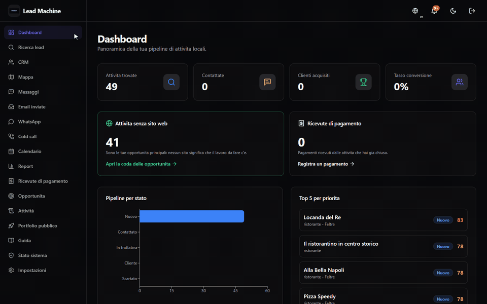

# Lead Machine

**A local-first CRM that finds nearby businesses on OpenStreetMap, scores the ones that need a website, and tells you which contact details are actually true before you call.**

`Next.js 15` · `TypeScript` · `Prisma + SQLite` · `v1.1.0` · `MIT` — [Code](https://github.com/AhsenKurtoski/lead-machine) · [API reference](https://github.com/AhsenKurtoski/lead-machine/blob/main/API.md) · [← Back to profile](../README.md)

  

Recorded from the running application, 21 November 2026. Not a mockup.

---

## 1. The problem

A freelancer or a two-person agency needs local clients. The work is always the same and always manual: find businesses in an area, check whether they have a website, find a phone number, find out whether that number still works, then keep track of who was contacted and when.

The tools that do part of this cost €50–€200 a month, keep the data in someone else's account, and — the part that matters — **do not tell you what is true**. A scraped phone number is presented as a phone number even when it is disconnected. An address is presented as an address even when it is a municipality without a street. You find out while the phone is ringing, and the damage is a wasted call and a slightly worse reputation.

So the real requirement is not "find leads". It is **"tell me what is verified, what is unknown, and why"** — with the data on my own disk and no subscription.

## 2. Why this solution

**Verification is a first-class feature, not a column.** Every field — phone, email, website, address, socials — gets a verdict (`verificato`, `da_verificare`, `non_raggiungibile`, `non_valido`, `assente`), the source of the verdict (`openstreetmap`, `controllo_diretto`, `ricerca_web`), a human-readable explanation and a timestamp, stored per lead. Email goes to a real MX lookup; the website gets a real HTTP request with response time and a `meta viewport` check; addresses go through real geocoding.

**A check that could not run is not a verdict.** This is the design decision I care most about. If the DNS resolver does not answer, or the site returns nothing at all, the field stays *to verify* and enters a retry queue with growing waits (5, 10, 20, 40 minutes, capped at 6 hours, 5 attempts). A network failure never turns into "not reachable", and the panel says which attempt it is on. The stored WhatsApp number or social link is likewise never treated as proof of ownership: without a real check, the field stays *to verify*.

**The score uses only what the lead actually has.** 0–100 from a missing or broken website, social presence, review count and rating, and reachable phone/WhatsApp/email. No distance premium, no affluence guess, no OSM-timestamp heuristics — those make a ranking that cannot be explained to the person being ranked.

**Nothing is invented when the configuration is missing.** The app ships no default city and no default brand: first run asks. A search without an explicit area and without a saved city returns `400` with a clear message instead of silently searching somewhere.

**Local-first, because the data is the product.** One `prisma/dev.db` SQLite file, portable, MIT, no paid tier, no feature gate. The whole interface is also translated into seven languages, because the same freelancer may work across a border.

**A public API, so the data is not trapped in the UI.** Scoped keys stored as SHA-256 hashes, four access profiles, permissions really enforced (a key without `search` gets `403` with `requiredScope` in the body), rate limits counted per key rather than per IP. Another tool — a website builder, a script, an agent — can consume the CRM instead of copying it.

## 3. Architecture and stack

- **Frontend and server** — Next.js 15 App Router, React 18, TypeScript 5.6, Tailwind + shadcn/ui, Leaflet for the map, Recharts for reports.
- **Data** — Prisma 5 over SQLite; `npm run setup` creates and seeds the database. Optional deployment path to Cloudflare Workers + D1 already scripted (`cf:build`, `cf:preview`, `cf:deploy`, D1 migrations, Prisma's D1 adapter); the primary target remains a laptop with a file.
- **Geography** — OpenStreetMap **Overpass** with automatic failover across public mirrors, optional **Geoapify** as a second source, results merged; **Nominatim** geocoding with **Photon** fallback, no API key. A three-layer deduplication (OSM id, then `name+city`, then fuzzy) keeps the CRM clean.
- **Enrichment** — the lead's site is fetched and parsed for public emails and social profiles; directory and marketplace links are filtered out. Playwright takes the homepage screenshot.
- **AI (optional)** — Gemini and Groq with automatic failover, for cold-call scripts, follow-up drafts, contact enrichment confidence and one-page demo sites. Without a key the AI endpoints answer `503`; the rest of the app works.
- **Auth** — a shared `APP_PASSWORD` with a signed `HttpOnly` cookie and same-origin CSRF for the UI, and `lm_live_…` keys for `/api/v1`. Without `APP_PASSWORD` the protected surface fails closed with `503` on every host, including a forged `Host` header.
- **Hardening** — CSP, HSTS in production, `X-Frame-Options`, `nosniff`, Referrer-Policy, Permissions-Policy, remote image hosts disabled, and an SSRF guard that rejects loopback, private ranges, link-local, IPv6 and cloud metadata addresses.
- **Logic layout** — the important rules (verification, retry queue, search-area resolution, scoring, receipts, CSV) live in pure modules under `src/lib/`. That is what makes them testable without a browser and without mocks.

## 4. What it does

- **Search → pipeline** — category + radius + city, mirror failover, deduplication, then a score and a status (hot / warm / cold / bespoke) for every business.
- **Verification panel** — *Verifica ora* on one lead or in bulk, an honest `verified / pending / problems` summary, duplicate-group detection, and an automatic retry queue for the checks that failed for network reasons.
- **Contact enrichment** — official site, public emails and social profiles, with the confidence of the guess reported rather than hidden.
- **Opportunity queue** — the businesses with no website, ranked by how much they need the work, with one-click call, email or WhatsApp.
- **CRM** — one timeline per lead (calls, emails, WhatsApp, meetings, notes, follow-ups), email composer with optional SMTP send and `.eml` fallback, per-lead WhatsApp template, follow-up buckets (today / next 7 days / overdue / done).
- **Payment receipts** — number (`RICEVUTA-2026-001`), amount, method, date, printable and listed per client. Explicitly **not** an invoice: no VAT, no tax rates. The app tracks the payment, not the paperwork.
- **Reports** — funnel by status, city breakdown, tags, top leads, CSV and JSON export; a productivity heatmap.
- **Public API** — `/api/v1/leads`, `/api/v1/leads/{id}`, `/api/v1/search`, `/api/v1/demo/generate`, with scopes, per-key limits, CORS and machine-readable errors.

## 5. Screenshots and video

The GIF above is the running app: dashboard, live OpenStreetMap search, CRM pipeline and the opportunity queue.

- **Full demo video (MP4, 1080p):** [lead-machine-demo.mp4](https://github.com/AhsenKurtoski/lead-machine/blob/main/docs/assets/lead-machine-demo.mp4)
- **Screenshots (desktop and mobile):** dashboard, search, CRM, map, receipts and settings, in [`screenshots/`](https://github.com/AhsenKurtoski/lead-machine/tree/main/screenshots)

Every screenshot and the video are produced by the code itself: with the server running, `npm run screenshots` drives Playwright through the app at desktop and mobile sizes, and `npm run demo` renders the MP4 with cursor, lower-thirds, transitions and generated music. There is no public live instance: this app is meant to run on your machine with your own database, so there is nothing to log into.

## 6. Tests and known limits

**One command for the boring part.** `npm run qa` runs typecheck, lint, a seven-language key-parity check, the content guard, the hygiene guard and the unit tests. The unit suite is **14 test files** on Node's own runner (`node:test` + `tsx`, no extra framework) and it is deliberately mock-free: anything external is injected as a parameter.

What the unit tests actually cover: the verification engine (including "an empty lead must not invent anything"), the retry queue, search-area resolution, Nominatim/Photon parsing, the Overpass query builder and the User-Agent rules, onboarding, opportunity scoring, receipts and locale formatting, session signing and invalidation, minimum-privilege API keys, the SSRF guard, CSV formula neutralisation, and contact extraction from real HTML — plus filesystem guards on SEO metadata and canonical URLs.

**Checks that talk to the real world.**

- `npm run check:auth` starts **two production servers** and verifies `401/403/503` paths, the six security headers, session invalidation when the password changes, and fail-closed behaviour without `APP_PASSWORD` — including a forged `Host`. The test password is generated at runtime and never printed; the servers are stopped even when a check fails.
- `npm run smoke:api` runs against a live server: creates keys with all four profiles, proves every scope is enforced, checks CORS preflight and `404`s, then deletes what it created.
- `npm run smoke:geo` proves the geography works on real services: a search with explicit coordinates, the same search with only a city (resolved by real geocoding), and the public search endpoint with a real key.
- `npm run perf:check` measures response time and uncompressed bytes against budgets, and also asserts three behaviours a fast response would hide: the home is an HTTP `307` and not a meta refresh, the lead list does not carry the heavy fields, and the opportunity queue renders 25 rows at a time.
- `npm run check:hygiene` catches what a refactor leaves behind: an empty page returning `null`, a link or menu entry pointing at a removed route, an unreachable page, a `layout` without a `page`, an empty folder — and orphaned, duplicated or out-of-rule verification rows in the database.

**CI** (`.github/workflows/ci.yml`): an `app` job runs `qa` then a production build; a `smoke-api` job builds, prepares a database, starts the server, runs the API smoke tests and then the hygiene guard with `--require-db`, which *requires* the database and fails if the smoke tests left leads, keys or verification rows behind; a `live` job (scheduled only) runs the geographic and performance checks; a weekly `audit` job runs `npm audit`.

**Not covered — the honest list, from `docs/TESTING.md`:**

- visual and mobile rendering: no automated rendering test, the screenshots and video are generated but judged by eye;
- real SMTP delivery: without `SMTP_HOST` the app writes `.eml` files to `./tmp/emails/` by choice, and sending is not exercised;
- AI providers: smoke tests skip them on purpose to avoid burning quota;
- third-party availability: Overpass, Nominatim and Geoapify limits are not mine, and the app degrades with a warning rather than failing;
- automated accessibility audit: no axe or Lighthouse in CI, the basics (skip link, landmarks, ARIA, visible focus) are checked by hand;
- React components: no rendering tests, no testing library — the logic was moved into pure modules precisely to avoid needing them.

**Other limits.** Overpass mirrors rate-limit bursts from one IP, so a geographic smoke test can go red for reasons outside the app. The Cloudflare Workers + D1 deployment path is scripted but is not the primary target. And it is a single-user, local-first tool: `APP_PASSWORD` is one shared password, not accounts with roles.

## 7. Where it stands

**v1.1.0, MIT, in use and maintained.** The core loop works end to end against real data: search, score, verify with real DNS/HTTP/geocoding checks, contact, follow up, export. The verification engine, the retry queue and the public API are recent work, and they are the parts I would point at first, because they are the ones that change the product from a list of names into something you can trust on a call.

Open next: broader coverage of the verification rules, more sources beyond OpenStreetMap and Geoapify, and a first-run experience that explains the verification model instead of just showing a table.
