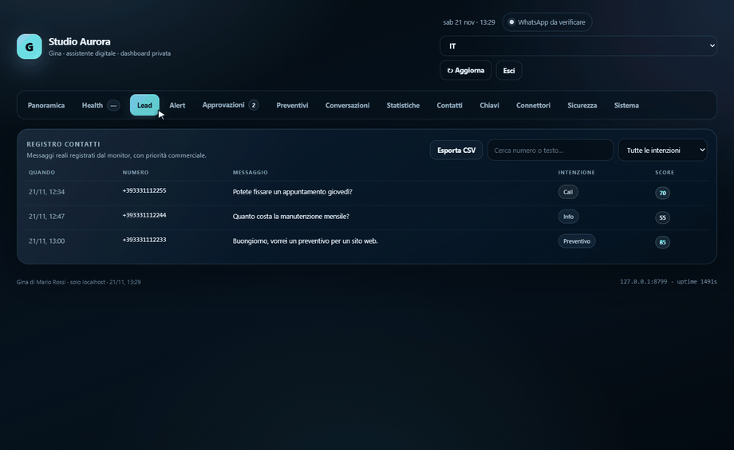

# WhatsApp Digital Secretary

**A private assistant that answers WhatsApp customers, prepares the quote, the email and the appointment — and sends nothing without the owner's approval.**

`Python 3.11–3.14` · `v1.1.1` · `MIT` · `self-hosted` — [Code](https://github.com/AhsenKurtoski/whatsapp-digital-secretary) · [Landing](https://gina-secretary.vercel.app) · [← Back to profile](../README.md)

<p align="center">
  
</p>

<sub>Recorded from the demo dashboard (`python3 demo.py`) on 21 November 2026. Not a mockup.</sub>

---

## 1. The problem

A small business — a professional practice, an electrician, a shop — lives on WhatsApp. Enquiries arrive while the owner is working, and the answers that matter (price, availability, appointment) are exactly the ones that cannot wait and cannot be guessed.

Two obvious answers exist and both fail for this user:

- **A generic chatbot** answers in a plausible tone but has no real price list, invents totals, and has no way to send anything useful.
- **A SaaS chatbot** solves the sending problem by taking the customer conversations, the phone number and the business data onto someone else's servers, and charging a monthly fee.

The owner's real objection is not "can it answer?" but **"can I let it write to my customers?"** A single wrong quote at 22% VAT, or an email sent to the wrong client, costs more than the subscription.

## 2. Why this solution

**Approval is an architectural property, not a prompt instruction.** The assistant has no Gmail and no Calendar tool at all. Its only three tools create *requests* — email, calendar event, PDF quote — in a local queue. The dashboard executes the action after the owner clicks. A jailbreak or a bad model turn can therefore fill the queue; it cannot send anything. This one decision shaped the rest of the product.

**Prices are recomputed on the server.** Services, prices, hours and tone live in one config file, and the quote PDF recalculates subtotal, discount, VAT and total in Python. The model chooses *what* to quote, never the arithmetic.

**It runs where the business already is.** A Python dashboard on `127.0.0.1:8787`, next to the gateway, no third-party dashboard service, no customer data leaving the machine. Encrypted per-customer memory (AES-256-GCM), a hash-chained audit log and encrypted backups follow from the same constraint.

**WhatsApp Web, not the Business Cloud API.** For a single small business the Cloud API needs Meta approval, templates and a phone number migration; the Web client works today with the number the customers already have. The trade-off is real and documented: automation can get a number restricted, so the project requires a dedicated number and ships an operational plan for it (`docs/WHATSAPP_BAN.md`). A Cloud API adapter is the first item on the roadmap, opt-in, with the Web client kept as the self-hosted fallback.

**Google Apps Script bridge over OAuth.** A Google OAuth app left in Testing mode expires its refresh token after about seven days, which would break the approval path every week. The bridge is a signed Apps Script web app (HMAC-SHA256) that exposes only `sendEmail` and `createEvent`, so the connection survives without publishing an app or owning a domain.

**Python for the dashboard** (standard library plus `cryptography`) because it has to run on the same cheap Linux box or WSL2 machine as the gateway, with no extra runtime to keep alive.

## 3. Architecture and stack

```text
WhatsApp (Web client)
        │
        ▼
OpenClaw gateway (Node.js, systemd user service)
        ├── per-customer session + context
        ├── model pool: Gemini first, Groq fallback
        ├── secretary-guard plugin (burst dedupe + technical-error scrubber)
        └── approval MCP tools (request email / calendar / PDF quote)
                 │
                 ▼
Local dashboard (Python, 127.0.0.1:8787)
        ├── approvals → Gmail / Google Calendar
        ├── leads, alerts, audit, key pool
        └── watchdog, monitor, digest timers
```

- **Gateway** — OpenClaw, one isolated session per phone number, a queue for bursts (`max_concurrent`), a model pool that switches on 429s.
- **Guard plugin** — coalesces rapid messages, drops duplicate inbound copies *before* the model is called, cancels an identical reply within 45 seconds, and replaces provider errors with a short human line.
- **Dashboard** — token login with constant-time comparison, `HttpOnly` + `SameSite=Strict` cookie, CSRF header and origin check, login rate limiting, CSP and `X-Frame-Options: DENY`. Loopback only; remote use goes through Tailscale + an SSH tunnel so the origin stays loopback.
- **Data** — contact files and backups encrypted with AES-256-GCM, key file at `0600`; the audit log hashes each entry into the previous one, so editing or removing a line breaks the chain.
- **Operations** — systemd user units, watchdog, health scan every 30 minutes with deduplicated WhatsApp alerts, `doctor.py` with `--fix`.
- **Stack** — Python 3.11–3.14 (CI covers all four), Node.js 22+, OpenClaw 2026.4.22+, optional `gog` CLI or the Apps Script bridge, MIT.

## 4. What it does

- **First contact in the business tone** — greets by the WhatsApp contact name, asks what the customer needs, and does not quote before it knows.
- **Lead qualification** — intent (quote, call, support, suspicious), score, audit trail without storing full message text.
- **Durable customer memory** — confirmed facts (company, budget, service, preferred contact) survive restarts and come back in the brief, so the customer is not asked twice. Sensitive values are redacted before writing.
- **PDF quotes** — branded A4 with items, discount, VAT and totals recalculated server-side; expiry date, search, duplication for a revised version, CSV export for the accountant.
- **Approval queue** — email, calendar event and quote each wait for one click; approving twice cannot send twice, and rejecting sends nothing.
- **Quote recall and resend** — a customer asking "send me the PDF again" gets a regenerated PDF and a new approval request.
- **Conversations** — read-only transcripts with personal data masked, and a handoff that returns control to the owner and back.
- **Manual quotes** — the owner can build a quote from the dashboard without the bot, the AI provider or WhatsApp at all.
- **Bilingual dashboard and replies** (IT/EN), owner reminders, anti-fraud rules (never asks for OTPs, passwords or payments; ignores role-play and prompt extraction), business-only scope.
- **Self-diagnosis** — `doctor.py` checks the installed files, the PDF engine, the MCP allowlist, the systemd units and the local APIs, and prints the command that fixes each failure.

## 5. Screenshots and video

The GIF at the top is the demo dashboard: lead registry with intents and scores, the quote list with a real generated PDF, the approval queue, and the conversation list. Two more captures from the approval email:

- [Quote email, desktop](https://github.com/AhsenKurtoski/whatsapp-digital-secretary/blob/main/docs/email-preview.png)
- [Quote email at 375 px](https://github.com/AhsenKurtoski/whatsapp-digital-secretary/blob/main/docs/email-preview-mobile.png)

The dashboard is private by design; what is public is the landing site at [gina-secretary.vercel.app](https://gina-secretary.vercel.app) and the one-command demo (`python3 demo.py`) that opens the same interface with demo leads and a generated quote, sending nothing.

## 6. Tests and known limits

**What runs.** `bash scripts/verify.sh` is one command for the whole matrix: compile check, the unit suite (**322 tests at the time of writing**), the isolated installer tests, the remote-access tests, the OpenClaw compatibility tests, a link check over the documentation, the site build and SEO audit self-tests, the Apps Script handlers, the guard plugin, the bridge, and eleven module self-tests. CI runs it on Python 3.11, 3.12, 3.13 and 3.14 — green on 20 November 2026. Coverage gate 86%, currently 87%; `ruff`, `mypy`, `bandit` and `pip-audit` run alongside.

The suite is hermetic: temporary home, demo configuration, no network. When a test needs a tool that is not installed, it asserts the graceful failure path instead of skipping silently.

**What is checked by hand, and documented.** `docs/TESTING.md` carries a 19-message WhatsApp checklist — price without a configured price, appointment collection, an angry customer, a fake "I am the owner" claim, prompt extraction, an OTP request, six identical messages in a row, five numbers writing at once — plus a dashboard checklist (double-approve, timezone, CSRF, 375/768/1280 px, keyboard, IT/EN switch) and six failure-and-recovery drills (kill the gateway, kill the dashboard, drop the network, exhaust a key, fill the queue, corrupt a log line).

**What CI cannot verify**, stated in the same document:

- a real WhatsApp session and QR login;
- real Gmail/Calendar delivery — the bridge health probe reaches both services, but actual delivery needs the owner's live authorisation and a manual test;
- provider quotas and latency;
- Windows auto-start and WSL behaviour.

**Known limits.**

- WhatsApp Web automation can get a number restricted. Mitigation: dedicated number, documented plan, Cloud API adapter on the roadmap — not a solved problem.
- Linux or WSL2 with systemd user services. No Docker path, no macOS, no plain Windows.
- The dashboard is loopback-only. Working from another device needs Tailscale + SSH.
- Free AI tiers reject bursts. A single Gemini key can return 429 on five simultaneous conversations; the answer is a key pool or a lower `max_concurrent`, and the queue absorbs the rest.
- The public site's Lighthouse numbers (100/100/100/100 on three pages, LCP ~0.8 s, measured 19 November 2026) describe the landing page, not the dashboard.

## 7. Where it stands

**v1.1.1, MIT, working and self-hosted.** Not a prototype and not a roadmap: releases are tagged, CI is green, and every claim above maps to a file, a command or a test in the repository. The public landing page is live; the dashboard is private by design.

Next, ordered by what removes the most risk for a real business: the WhatsApp Cloud API adapter, voice messages, inbound email, calendar availability rules, a cited knowledge base, online quote acceptance, signed approvals from WhatsApp, then more channels and a CRM bridge. Items already shipped — TOTP, short revocable sessions, encrypted memory, tamper-evident audit, off-site backups — are not on that list.

It is independent software built on top of WhatsApp Web and OpenClaw. It is not a WhatsApp or Meta product and is not affiliated with either.
